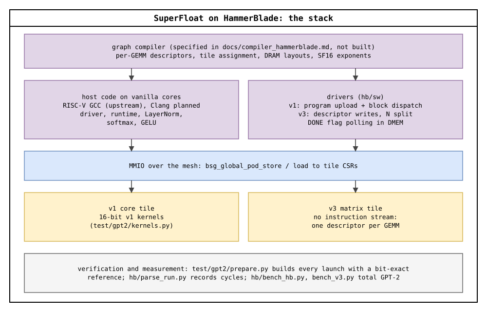
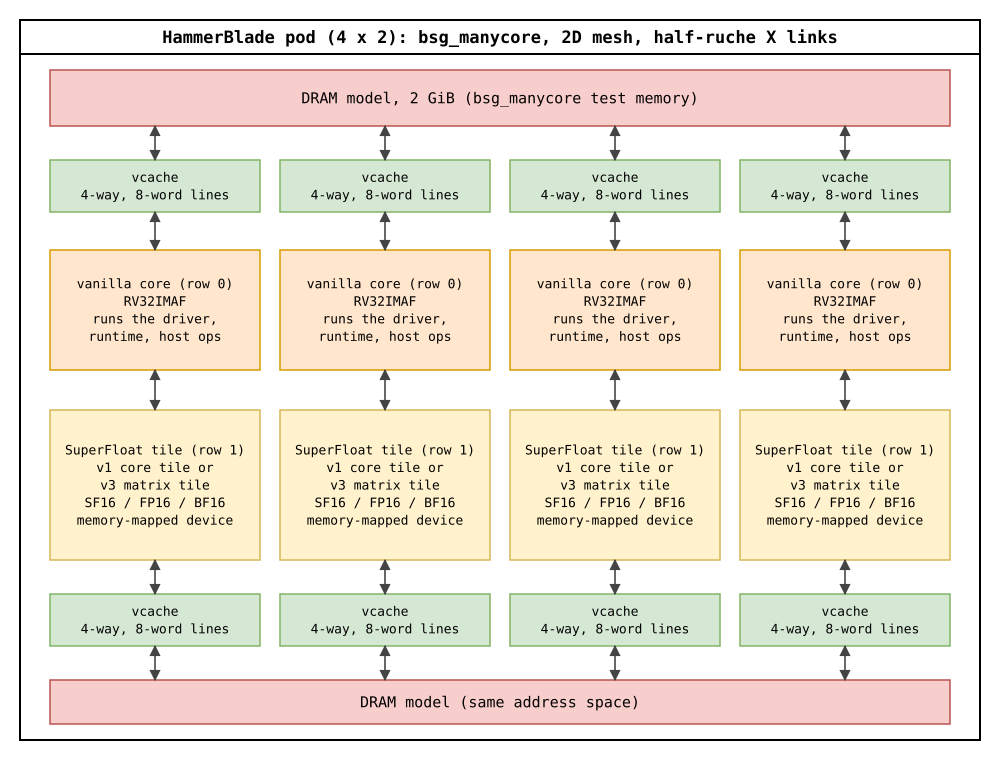
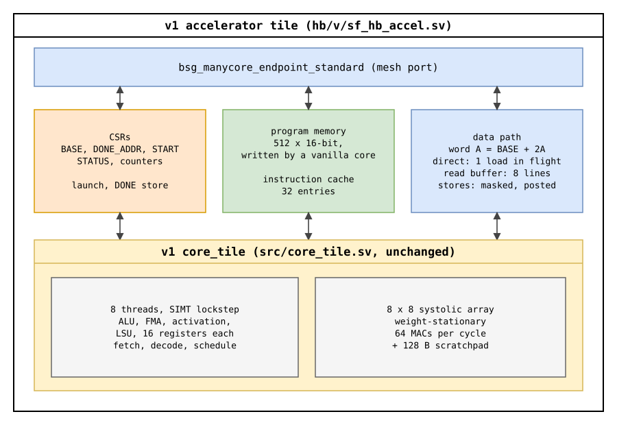
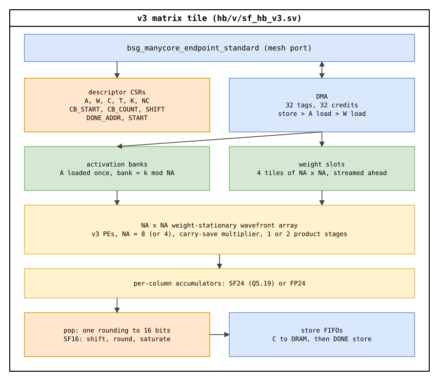

# SuperFloat on HammerBlade

SuperFloat's matrix tiles running inside a **HammerBlade manycore pod**. HammerBlade is the Bespoke Silicon Group's open-source `bsg_manycore` (University of Washington): RISC-V cores on a 2D mesh, with caches in front of DRAM.

In this branch, each SuperFloat tile is a memory-mapped device on that mesh:
- HammerBlade's RISC-V cores run all the code;
- the SuperFloat tiles do the matrix arithmetic, reading and writing DRAM through the pod's caches.

Every tile runs in three number formats, SF16 (SuperFloat's Q1.15), FP16 and BF16, on the pod's RTL. **708 launches** of GPT-2 small's matrix work are each checked bit for bit against a reference, and all match.

| | |
|---|---|
| Platform | `bsg_manycore` 0052ce8, simulated in Verilator (983a06a) |
| Pod | 4 × 2 tiles: four RISC-V "vanilla" cores (row 0), four SuperFloat tiles (row 1) |
| Memory | 8 vcaches (64 KB in all, 4-way, 8-word lines) in front of a 2 GiB DRAM model |
| Network | 2D mesh with half-ruche links in X |
| Tile kinds | **v1 core tile**: 8 SIMT threads and an 8 × 8 systolic array, running a 16-bit program. **v3 matrix tile**: an 8 × 8 (or 4 × 4) wavefront array with its own DMA, driven by a descriptor. |
| Formats | SF16 (sign-magnitude Q1.15), FP16, BF16; accumulators SF24 (v3 SF16) or FP24 (v3 FP16, BF16) |
| Machines | 21 pod configurations (`hb/machines/`), one tile kind and format per machine |
| Verification | 708 launches bit-exact: 528 on v1 tiles, 180 on v3 tiles |
| Results | v3 tiles at their 2 nm clocks, GPT-2 small, 32-token prompt: the prefill's matrix multiplies take **17.1 ms** (SF16), 19.2 ms (FP16), 19.1 ms (BF16) |

### Contents

- [How this differs from the 130 nm and 2 nm builds](#how-this-differs-from-the-130-nm-and-2-nm-builds)
- [The stack](#the-stack)
- [Architecture](#architecture)
  - [The pod](#the-pod)
  - [v1 core tile](#v1-core-tile)
  - [v3 matrix tile](#v3-matrix-tile)
  - [Memory and addressing](#memory-and-addressing)
  - [Launch and completion](#launch-and-completion)
- [Number formats](#number-formats)
- [Programming a tile](#programming-a-tile)
- [Results](#results)
- [Machines](#machines)
- [Repository layout](#repository-layout)
- [Building and running](#building-and-running)
- [What is measured and what is not](#what-is-measured-and-what-is-not)

---

## How this differs from the 130 nm and 2 nm builds

The same SuperFloat arithmetic exists in three implementations. This branch is the third.

| | v1 OpenFrame chip, 130 nm (`cf-openframe`) | v3 core, 2 nm (`gt2n`), planned | **HammerBlade (this branch)** |
|---|---|---|---|
| What it is | A whole chip: four v1 core tiles on a SKY130 OpenFrame die | A core planned on GT2N: a RISC-V control core, a vector unit and four 128 × 128 matrix units | SuperFloat tiles inside someone else's manycore |
| Who runs the code | The chip's own dispatcher and SIMT threads | Its own RISC-V control core | HammerBlade's RISC-V vanilla cores |
| Path to memory | A 16-bit pin bus to external memory, shared by all four tiles | On-die SRAM and HBM (modeled) | The pod's mesh and vcaches to DRAM, one port per tile |
| How a tile is driven | Through the chip's pins | Its instruction set | Stores to the tile's registers over the mesh (memory-mapped) |
| SF16 in memory | Sign-magnitude Q1.15 | Two's complement, converted at the matrix-unit inputs | Sign-magnitude Q1.15 |
| Status | Signed off for SKY130 | Matrix-unit blocks measured on GT2N to global routing; the rest of the core is not RTL yet | Simulated: the pod's RTL in Verilator |

**What changes in HammerBlade:**
- **No pin bus and no chip top level.** The tile itself is the only limit on its clock.
- **Four tiles load in parallel.** On the chip, all four shared one bus.
- **Control moves to the vanilla cores,** which take over the chip's dispatcher, the host's launch sequence and the operations between matrix multiplies.
- **The v1 tile runs unchanged.** An adapter puts it on the mesh.
- **The v3 tile is new for HammerBlade.** It is sized to what a mesh port can deliver (one 32-bit word per cycle), with an 8 × 8 array instead of the 2 nm core's 128 × 128.

## The stack



| Layer | What it is | Where |
|---|---|---|
| Graph compiler | Turns a model into per-GEMM tile descriptors, DRAM layouts and SF16 exponents. Specified, not built. | `docs/compiler_hammerblade.md` §6 |
| Host code | C on the vanilla cores, built with HammerBlade's RISC-V GCC. Runs the driver and the operations between matrix multiplies (LayerNorm, softmax, GELU). | `hb/sw/` |
| Drivers | v1: upload a 16-bit program, then hand each free tile the next thread block. v3: write one descriptor per tile and wait for its done flag. | `hb/sw/main.c`, `hb/sw/v3/main.c` |
| MMIO | Each tile's registers, reached with `bsg_global_pod_store` / `bsg_global_pod_load` | `docs/compiler_hammerblade.md` §1 |
| Tiles | The v1 core tile and the v3 matrix tile, in SF16, FP16 and BF16 | `hb/v/`, `hb/v3/`, `src/` |
| Kernels and references | GPT-2 small's matrix work, with real operands and a bit-exact expected result for every launch | `test/gpt2/` |
| Measurement | Per-launch cycle records, GPT-2 totals, figures | `hb/parse_run.py`, `hb/bench_hb.py`, `hb/bench_v3.py`, `hb/results/` |

`docs/compiler_hammerblade.md` is the reference for whoever writes the toolchain and runtime. It covers address maps, descriptors, data layouts, numerics, launch and completion, and the toolchain, each with file and line citations.

---

## Architecture

### The pod



- **Layout:** a 4 × 2 array. Row 0 holds four RV32IMAF vanilla cores. Row 1 holds four SuperFloat tiles, all of one kind and one format.
- **Memory:**
  - eight vcaches, four on each edge, 64 sets × 4 ways × 8-word lines (8 KB each);
  - behind them, bsg_manycore's 2 GiB DRAM model.
  - The v3i machines turn on the vcaches' IPOLY address hashing, as full-size HammerBlade pods do.
- **Network:** every tile, vanilla or SuperFloat, reaches every vcache and every other tile over the mesh.
- **How the SuperFloat row is built:**
  - Each SuperFloat tile sits behind HammerBlade's standard tile endpoint (`bsg_manycore_endpoint_standard`).
  - It takes one of 18 tile types, numbered 9 to 26 in `hb/v/bsg_manycore_hetero_socket.sv`.
  - A machine picks the type for row 1 with `SF_ACCEL_ROW` and `SF_ACCEL_TYPE`.
- **What the SuperFloat tiles don't do:** they run no RISC-V code and don't join the hardware barrier.

### v1 core tile



The OpenFrame chip's compute macro (`src/core_tile.sv`), unchanged, behind an adapter (`hb/v/sf_hb_accel.sv`).

- **The core:**
  - 8 threads in SIMT lockstep, each with an ALU, an FMA, an activation unit, a load/store unit and 16 registers;
  - one 8 × 8 weight-stationary systolic array (64 MACs per cycle);
  - a 128 B scratchpad.
- **Program:**
  - A vanilla core writes the 16-bit program into a 512-word program memory with one store per instruction.
  - The chip's 32-entry instruction cache sits in front of it, flushed on any program write.
- **Data:**
  - The tile's 16-bit word address A is the halfword at `BASE + 2A` in DRAM.
  - Direct adapter: each read is one halfword remote load. The core has one data channel, so one load is in flight at a time.
  - Read-buffer adapter (`_rb`): the adapter holds 8 whole vcache lines (32 B each). A miss fetches its line with 8 loads in flight; a hit is answered the next cycle and prefetches the next line.
  - Writes are masked remote stores, up to 32 posted.
- **Dispatch:** the driving vanilla core acts as the chip's block scheduler. It gives each tile a block id and thread count, and the next block when a tile reports done.

**v1 instruction set** (16-bit, opcode in `[15:12]`; decoder `src/decoder.sv`):

| Opcode | Instruction | | Opcode | Instruction |
|---|---|---|---|---|
| `0x0` | NOP | | `0x7` | LDR rd, [rs] |
| `0x1` | BR nzp, off9 | | `0x8` | STR [rd], rs |
| `0x2` | CMP | | `0x9` | CONST rd, imm8 |
| `0x3` | ADD | | `0xA` | FMA (Q1.15) |
| `0x4` | SUB | | `0xB` | ACT (bias + activation) |
| `0x5` | MUL | | `0xC` | SYS: systolic clear, load, compute, read |
| `0x6` | DIV | | `0xF` | RET |

R13 holds `%blockIdx`, R14 `%blockDim` and R15 `%threadIdx`. The GPT-2 kernels are in `test/gpt2/kernels.py`.

### v3 matrix tile



A tile built for HammerBlade (`hb/v/sf_hb_v3.sv`) around v3's processing elements (`hb/v3/v3_pe.sv`, `v3_block.sv`). It has **no instruction stream.** One launch computes C = A · W for a range of C's columns, all three matrices in DRAM:

```
C[T × NC] (column blocks CB_START .. CB_START + CB_COUNT - 1) = A[T × K] · W[K × NC]
```

- **Array:** NA × NA weight-stationary wavefront array (NA = 8, or 4 on the `a4` machines).
  - Carry-save multiplier, with one product stage, or two on the `m2` machines.
  - Weight tiles stream in back to back: a tile swaps in as the activation wavefront reaches it.
- **DMA:** 32 load tags and 32 outstanding requests. Each cycle a result store goes first, then an A load, then a W load.
- **Buffers:**
  - A is loaded once into NA activation banks (bank = k mod NA).
  - W streams through 4 weight slots, up to 4 tiles ahead of the array.
- **Accumulate and round:**
  - Per-column accumulators in SF24 (Q5.19) for SF16, and FP24 for FP16 and BF16.
  - After the last pass of a column block, the "pop" rounds each sum once to 16 bits.
  - Results leave through store FIFOs, two values per 32-bit word.
- **Limits:** T ≤ 128 rows, K ≤ 3072 and a multiple of NA, NC a multiple of NA. W is laid out in NA × NA tiles, so weights are tiled offline for the machine's NA.
- **Why 8 × 8:** a tile's port returns at most one 32-bit word, two 16-bit values, per cycle. Each NA × NA weight tile is used by T activation rows, so the array keeps up with the port when NA²/2 ≈ T. That gives NA = 8 for prompts of about 32 tokens. A 128 × 128 array would sit idle.

### Memory and addressing

- **Shared memory:** DRAM is one address space for every tile. A vanilla core's `.dram` pointer (`0x8xxx_xxxx`) is a valid A, W, C or BASE address for a SuperFloat tile, which translates it with HammerBlade's own `bsg_manycore_eva_to_npa`.
- **Tile registers:** a tile's registers sit at word addresses `0x2000 + i`, byte offset `0x8000 + 4i`. Use 32-bit stores; byte masks are ignored.

| v1 register | | v3 register | |
|---|---|---|---|
| `0x2000` BASE | window base | `0x2000-0x2002` A_BASE, W_BASE, C_BASE | operand addresses |
| `0x2001` DONE_ADDR | completion flag | `0x2003-0x2005` T, K, NC | shape |
| `0x2002` START | block id, thread count | `0x2006-0x2007` CB_START, CB_COUNT | column blocks |
| `0x2003` STATUS | busy | `0x2008` SHIFT | SF16 output exponent |
| `0x2004-0x2007` | cycle, busy, read and write counters | `0x2009` DONE_ADDR, `0x200A` START | completion, launch |
| `0x2008` FORMAT | 0 SF16, 1 FP16, 2 BF16 | `0x200B-0x2014` | status, counters, FORMAT, NA, pipeline depths |

The full maps, with every field's constraints, are in `docs/compiler_hammerblade.md` §2.1 and §3.2.

### Launch and completion

The same protocol serves both tiles:

1. A vanilla core writes the tile's registers: the program and BASE (v1), or the descriptor (v3).
2. It writes DONE_ADDR: the address of a flag in its own local data memory.
3. It clears the flag.
4. It writes START.
5. The tile runs, waits until every one of its result stores has been acknowledged, then stores 1 into the flag of whichever core wrote START.
6. The core spins on its local flag, which costs no network traffic. When the flag reads 1, the results are in memory and visible to every core.

Any vanilla core can own any tile, and several can each drive their own.

---

## Number formats

**SF16 is sign-magnitude Q1.15 in memory:** bit 15 is the sign, bits 14–0 the magnitude, and the value is (−1)^s · m / 2^15 · 2^e. The scale e is a power of two kept by software per tensor (v3), or per token and per channel by the host. Zero is `0x0000`, and `0x8000` is never produced.

```python
def to_sf16(x, e):            # e: per-tensor exponent, max|x| / 2**e < 1
    m = min(round(abs(x) * 2 ** (15 - e)), 32767)   # round half to even
    return (int(x < 0) << 15 | m) if m else 0
```

**FP16** is IEEE binary16. **BF16** is the top 16 bits of an FP32. Both read subnormal inputs as zero.

**What each tile computes:**

| Tile | Format | Product | Accumulator | Output |
|---|---|---|---|---|
| v1 | SF16 | 15 × 15 magnitude product, truncated to Q1.15 | 16-bit two's complement, saturating at ±32767 | sign-magnitude SF16 |
| v1 | FP16, BF16 | exact | one rounding to the 16-bit format per MAC | FP16 / BF16 |
| v3 | SF16 | partial-product columns below 9 dropped plus 1024, cut to 19 fraction bits | SF24 (Q5.19), saturating | pop: shift right by SHIFT, round half to even, saturate |
| v3 | FP16 | 11 × 11 significands, columns below 4 dropped plus 12 | FP24 (1/8/15), one RNE rounding per MAC | pop: round FP24 to FP16 |
| v3 | BF16 | exact | FP24, one RNE rounding per MAC | pop: round FP24 to BF16 |

**For v3 SF16, the compiler picks the output exponent:** SHIFT = 4 + e_C − e_A − e_W. The output then carries exponent e_C, so a GEMM's output can be the next GEMM's A unchanged. The bit-exact reference is `hb/sw/v3/mxu_emu.py`; `docs/compiler_hammerblade.md` §4 gives every rounding rule.

---

## Programming a tile

One GEMM on the four v3 tiles from the vanilla core at (0,0), shortened from `hb/sw/v3/main.c`. The column blocks are split across the tiles, and every tile reads all of A:

```c
#include "bsg_manycore.h"
#define CSR(i) ((0x2000 + (i)) << 2)
static volatile int done_flag[4];                       /* in the core's local data memory */

static inline void acc_store(int t, int i, int v) { bsg_global_pod_store(0, 0, t, 1, CSR(i), v); }

void gemm_v3(const short *A, const short *Wt, short *C, int T, int K, int N, int na, int shift)
{
  int cbs = N / na;                                     /* column blocks of na columns */
  for (int t = 0; t < 4; t++) {                         /* tile t of row 1 */
    int s = cbs * t / 4, e = cbs * (t + 1) / 4;
    if (e == s) continue;
    acc_store(t, 0, (int) A);  acc_store(t, 1, (int) Wt);  acc_store(t, 2, (int) C);
    acc_store(t, 3, T);        acc_store(t, 4, K);         acc_store(t, 5, N);
    acc_store(t, 6, s);        acc_store(t, 7, e - s);     acc_store(t, 8, shift);
    acc_store(t, 9, ((int) &done_flag[t]) >> 2);        /* DONE_ADDR */
    done_flag[t] = 0;
    acc_store(t, 10, 1);                                /* START */
  }
  for (int t = 0; t < 4; t++)
    if (cbs * (t + 1) / 4 > cbs * t / 4) while (!done_flag[t]) ;
}
```

- **Before launching,** read each tile's NA (register 19) and FORMAT (16), and check them against what the weights were tiled and quantised for.
- **If this core wrote the operands itself,** call `bsg_fence()` before START.
- **v1 tiles** use the same pattern with a program upload and a block loop: `hb/sw/main.c`.

---

## Results

All cycles are measured on the pod's RTL in Verilator, with every output checked bit for bit. Times and energies combine those cycles with clocks and power measured on hardened tiles. Full tables: `docs/hammerblade.md`.

### v3 matrix tiles: GPT-2 small prefill

Clocks from each format's array hardened on GT2N (2 nm) to global routing. Times count the prefill's matrix multiplies only. 180 launches, all bit-exact.

| | SF16 | FP16 | BF16 |
|---|---|---|---|
| Array clock, 2 nm | **3.39 GHz** | 3.01 GHz | 3.03 GHz |
| Cycles, 32-token prompt (v3i, 8 × 8) | 57.81 M | 57.79 M | 57.79 M |
| Time to first token, 8 tokens | **16.0 ms** | 18.0 ms | 17.9 ms |
| Time to first token, 32 tokens | **17.1 ms** | 19.2 ms | 19.1 ms |
| Time to first token, 128 tokens | **22.7 ms** | 25.6 ms | 25.4 ms |

- **Cycles agree within 2.5% across formats,** so SF16's lead is its arrays' higher clock: about 11% less time than FP16 and BF16.
- **The tiles are bandwidth-bound.** The eight vcaches deliver about 1.4 words per cycle to the four tiles together, so the arrays wait for weights. 4 × 4 arrays don't help: 1.1× the cycles at 32 tokens and 2.7× at 128.

### v1 core tiles: GPT-2 small, 32-token prompt and 32 generated tokens

Four tiles per format, at each tile's SKY130 signoff clock (ss, 100 °C, 1.60 V). Times count the matrix work only. 528 launches, all bit-exact.

| | SF16 | FP16 | BF16 |
|---|---|---|---|
| Tile clock (ss) | 51.9 MHz | **55.7 MHz** | 54.1 MHz |
| Time to first token, read buffer | 64.4 s | **60.1 s** | 61.8 s |
| Time per output token, read buffer | 7.80 s | **7.27 s** | 7.48 s |
| Energy per output token (4 tiles) | **1.97 J** | 3.66 J | 3.50 J |
| Tile standard-cell area | **1.40 mm²** | 1.86 mm² | 1.63 mm² |

- **Against the OpenFrame chip,** the same tiles take 1.15–1.16× fewer cycles with the direct adapter. With the read buffer they take 2.16–2.23× fewer on prefill and 2.73× fewer on decode.
- **SF16 uses 46% less energy than FP16 and 44% less than BF16.** Cycles are identical across formats, so the tiles' power sets the ratio.
- **A v1 tile does about the work of one vanilla core running FP32.** Its threads feed the 8 × 8 array one load at a time. That is why the v3 tile, whose DMA feeds the array directly, is the one to integrate.

---

## Machines

Each machine is a 4 × 2 pod with one kind of SuperFloat tile in row 1 (`hb/machines/<name>/Makefile.machine.include`):

| Machines | Tile | Array | Product stages | IPOLY hashing | Socket types |
|---|---|---|---|---|---|
| `sf_4x2_{sf16,fp16,bf16}` | v1, direct adapter | 8 × 8 | – | off | 9, 10, 11 |
| `sf_4x2_{sf16,fp16,bf16}_rb` | v1, 8-line read buffer | 8 × 8 | – | off | 12, 13, 14 |
| `v3_4x2_{sf16,fp16,bf16}` | v3 | 8 × 8 | 1 | off | 15, 16, 17 |
| `v3_4x2_*_m2` | v3 | 8 × 8 | 2 | off | 18, 19, 20 |
| `v3_4x2_*_a4` | v3 | 4 × 4 | 1 | off | 21, 22, 23 |
| `v3i_4x2_*_m2` | v3 | 8 × 8 | 2 | on | 18, 19, 20 |
| `v3i_4x2_*_m2a4` | v3 | 4 × 4 | 2 | on | 24, 25, 26 |

## Repository layout

| Path | Contents |
|---|---|
| `hb/v/sf_hb_accel.sv` | v1 adapter: endpoint, registers, program memory and instruction cache, data path, read buffer |
| `hb/v/sf_hb_v3.sv` | v3 matrix tile: descriptor, DMA, buffers, wavefront array, accumulators, pop |
| `hb/v/bsg_manycore_hetero_socket.sv` | HammerBlade's tile socket with the SuperFloat tile types 9–26 |
| `hb/v3/` | v3 processing element, block and FP arithmetic used by the v3 tile |
| `src/` | v1 RTL: `core_tile.sv` and everything under it (renamed `sf1_*` in the build copy by `hb/v1_prefix.py`) |
| `hb/machines/` | the 21 pod configurations |
| `hb/sw/` | drivers on the vanilla cores (`main.c` v1, `v3/main.c` v3), launch generators, the FP32 baseline (`vanilla/`) |
| `hb/setup_pod.sh`, `hb/sf_filelist.mk` | wire SuperFloat into a `bsg_manycore` checkout (four small edits) |
| `hb/run_launch.sh`, `run_all.sh`, `parse_run.py` | build, run and record launches |
| `hb/bench_hb.py`, `bench_v3.py`, `make_fig.py` | GPT-2 totals and figures |
| `hb/tools/make_diagrams.py` | the architecture diagrams in `docs/images/hb_*.svg` |
| `hb/results/` | every launch's record, tile signoff and clock numbers, totals, tool versions |
| `test/gpt2/` | GPT-2 small launches with real operands and bit-exact references (`prepare.py`), v1 kernels (`kernels.py`), format models |
| `docs/hammerblade.md` | measured results and method |
| `docs/compiler_hammerblade.md` | compiler and runtime reference |

## Building and running

On a Linux host with Verilator 5 and HammerBlade's RISC-V GCC (`software/riscv-tools`: `checkout-riscv-gnu-tools build-riscv-gnu-tools`):

```bash
git clone https://github.com/bespoke-silicon-group/bsg_manycore.git
git clone https://github.com/bespoke-silicon-group/basejump_stl.git
make -C bsg_manycore checkout_submodules && make -C basejump_stl/imports DRAMSim3
hb/setup_pod.sh bsg_manycore .
make -C bsg_manycore/machines sf_4x2_sf16/simsc BSG_PLATFORM=verilator IGNORE_CADENV=1
MC=$PWD/bsg_manycore ROOT=$PWD RUNS=$PWD/runs hb/run_launch.sh sf16 gemv_check
```

- **Launches:** built by `test/gpt2/prepare.py` from GPT-2 small (`GPT2_DIR` holds `model.safetensors` and `tokenizer.json`).
- **Batch runs and the FP32 baseline:** `hb/README.md`.
- **The v3 tiles:** launches from `hb/sw/v3/gen_v3.py`, runs with `hb/run_v3.sh`; build and test steps are in `docs/compiler_hammerblade.md` §5.
- **Tool versions:** `hb/results/versions.txt`.

## What is measured and what is not

- **Measured:**
  - cycles, on the RTL of the whole pod: cores, mesh, vcaches and DRAM model;
  - bit-exact outputs for all 708 launches;
  - the tiles' clocks, power and area, hardened separately: v1 at SKY130 (signed off for the OpenFrame chip), v3's arrays at GT2N to global routing.
- **Not measured:**
  - **Process.** The pod itself is not hardened, and its clock is assumed to match the tile's.
  - **HammerBlade's own power.** The mesh, vcaches, DRAM and vanilla cores are left out of the energy figures.
  - **DRAM.** The memory model is bsg_manycore's test memory, not an HBM2 model.
  - **Operations between matrix multiplies** (LayerNorm, softmax, GELU), which would run on the vanilla cores.
  - **A tuned FP32 baseline.** The vanilla-core comparison is untuned C.
- **Not built:** the graph compiler and a runtime library. The drivers in `hb/sw/` do their jobs for the measured launches.

HammerBlade (`bsg_manycore`, `basejump_stl`) is the work of the Bespoke Silicon Group. SuperFloat adds tiles to it and makes four small edits to the build, listed in `hb/README.md`.
