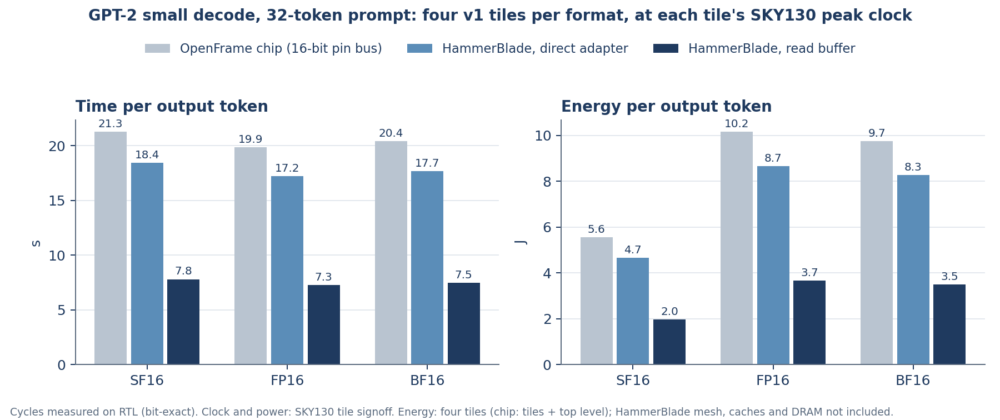

# SuperFloat v1 on HammerBlade

The v1 core tile runs inside a HammerBlade manycore pod, in all three number formats. HammerBlade is `bsg_manycore` from the Bespoke Silicon Group (Michael Taylor's lab, University of Washington). The design is in `hb/`, and how it attaches is in `hb/README.md`.

- **What was tested.** Every GPT-2 launch shape the benchmark needs (`docs/gpt2_benchmark.md`) ran on the HammerBlade RTL in Verilator:
  - SF16, FP16 and BF16;
  - with two adapters: direct, and with a read buffer;
  - 528 launches in all.
- **Result:** every stored output matches the bit-exact reference.

## Headline: 32-token prompt, 32 generated tokens

Four v1 tiles per format, at each tile's own peak clock (SKY130, ss, 100 °C, 1.60 V). On HammerBlade only the tile limits the clock: the chip's pin bus and top level are gone.

| | SF16 | FP16 | BF16 |
|---|---|---|---|
| Tile peak clock (ss) | 51.9 MHz | **55.7 MHz** | 54.1 MHz |
| **HammerBlade, read buffer** | | | |
| Prefill (TTFT) | 64.4 s | **60.1 s** | 61.8 s |
| Time per output token | 7.80 s | **7.27 s** | 7.48 s |
| End to end, 32 + 32 tokens | 306 s | **286 s** | 294 s |
| Energy per output token (4 tiles) | **1.97 J** | 3.66 J | 3.50 J |
| Energy, 32 + 32 tokens (4 tiles) | **77 J** | 144 J | 137 J |
| **HammerBlade, direct adapter** | | | |
| Prefill (TTFT) | 120.8 s | **112.7 s** | 115.9 s |
| Time per output token | 18.44 s | **17.20 s** | 17.69 s |
| Energy per output token (4 tiles) | **4.65 J** | 8.66 J | 8.27 J |
| **OpenFrame chip** (`docs/gpt2_benchmark.md`) | | | |
| Prefill (TTFT) | 140.2 s | **130.8 s** | 134.5 s |
| Time per output token | 21.3 s | **19.9 s** | 20.4 s |
| Energy per output token (tiles and top level) | **5.55 J** | 10.17 J | 9.74 J |

- **The format sets speed only through the clock.** All 88 launch shapes take identical cycles in SF16, FP16 and BF16, for both adapters. FP16 is fastest because its tile clocks 7% higher than SF16's and 3% higher than BF16's.
- **SF16 uses 46% less energy than FP16 and 44% less than BF16,** with either adapter. Energy per token is the tile's power at 50 MHz times its cycles, so the clock cancels out. The ratio is the tiles' power ratio: 60.7 mW against 113.0 and 108.0 mW, measured on the signed-off tiles.
- **Area:** the tiles' standard cells take 1.40 mm² (SF16), 1.86 mm² (FP16) and 1.63 mm² (BF16) at SKY130. SF16 is 25% smaller than FP16 and 14% smaller than BF16.

### Against the OpenFrame chip, in cycles

| | Prefill, 32 tokens | Decode, per token |
|---|---|---|
| OpenFrame chip (16-bit pin bus) | 7,281 M | 1,104 M |
| HammerBlade, direct adapter | 6,273 M (1.16× fewer) | 958 M (1.15×) |
| HammerBlade, read buffer | 3,347 M (2.18×) | 405 M (2.73×) |

The speedup is the same for 8- and 128-token prompts: 1.16× and 2.16–2.23× for prefill, 1.15–1.16× and 2.73× for decode.

## Why: per launch

SF16 cycles; FP16 and BF16 are identical. "Busy per read" is the tiles' busy cycles divided by the words they read: the whole cost of a read, including the instructions around it.

| Launch | K | Blocks | Words read | Chip | HammerBlade direct | HammerBlade read buffer | Busy per read (direct / buffer) | 4 vanilla cores, FP32 |
|---|---|---|---|---|---|---|---|---|
| `gemv_check` | 64 | 4 | 2,400 | 19,434 | 19,167 (1.01×) | 10,959 (1.77×) | 23.8 / 10.3 | |
| `gemm_check` | 32 | 4 | 2,144 | 22,849 | 21,855 (1.05×) | 14,475 (1.58×) | 29.3 / 15.8 | |
| `gemv_768_10` (decode) | 768 | 10 | 69,360 | 545,243 | 472,031 (1.16×) | 199,352 (2.74×) | 22.6 / 9.3 | 161,863 |
| `gemm_768_9` (prefill) | 768 | 9 | 110,808 | 1,125,087 | 968,415 (1.16×) | 521,855 (2.16×) | 26.5 / 14.0 | 468,624 |
| `att_qk_64_31` | 64 | 31 | 18,600 | 151,376 | 117,899 (1.28×) | 54,139 (2.80×) | 23.5 / 10.2 | |
| `pf_qk_64_31` | 64 | 31 | 32,488 | 321,421 | 239,667 (1.34×) | 130,946 (2.45×) | 27.6 / 14.8 | |

- **Direct adapter: a read costs about 22–30 cycles on HammerBlade. On the chip a bus transfer takes about 7.8 cycles, but four tiles share the bus.**
  - `core_tile` has one data channel and waits for each word, so a tile has one 16-bit load in flight.
  - The load crosses the mesh to a vcache and back. Its operands come from DRAM after a cold start: the driver evicts the vcaches before each launch.
  - HammerBlade still wins slightly, because its four tiles load in parallel while the chip's four share one bus.
- **Read buffer: 9–16 busy cycles per read, and the tile becomes the limit.** The buffer holds 8 lines of 32 bytes in the adapter and fetches each line with 8 word loads in flight, prefetching the next line on a hit.
  - What remains is the v1 core's own pipeline. Each instruction is fetched, decoded and run for 8 threads, and a load waits for its answer.
  - The buffer fetches 1.00–1.16 halfwords per halfword the tile reads (`loads` in `hb/results/*_rb.jsonl` counts 32-bit words), so prefetching wastes little.
- **Against HammerBlade's own cores, a v1 tile is about one vanilla core.** The same `gemv_768_10` and `gemm_768_9` in FP32, as straightforward untuned C on the four vanilla cores of the same pod (`hb/sw/vanilla`):
  - 161,863 and 468,624 cycles;
  - against 199,352 and 521,855 for the four v1 tiles with the read buffer.
  - So per tile, v1 does 0.08 MACs per cycle on decode and 0.21 on prefill, against 0.09 and 0.24 for one vanilla core in FP32. Its 8 × 8 array (64 MACs per compute) waits on the instructions that feed it.
  - Integrating a SuperFloat tile pays off only with a datapath that feeds the array directly, as v3's does, not with v1's thread-per-lane load path.

## What was built

- **Adapter** (`hb/v/sf_hb_accel.sv`): one unchanged v1 `core_tile` behind HammerBlade's standard endpoint.
  - Program: the chip's 32-entry instruction cache in front of a 512-word program memory, written by the launching core.
  - Data: the tile's 16-bit word address A is the halfword at BASE + 2A in DRAM.
    - Direct: a halfword remote load per read.
    - Read buffer: a whole vcache line per miss.
    - Writes are masked remote stores.
  - Launch: a HammerBlade core writes the block id and thread count. The tile signals completion by storing into the launching core's data memory once all its stores are acknowledged.
- **Pod** (`hb/machines/`):
  - 4 × 2 tiles: four vanilla RISC-V cores in row 0, and four SuperFloat tiles of one format in row 1;
  - 8 vcaches (64 KB in all) in front of DRAM.
  - One machine per format and adapter: six machines.
- **Driver** (`hb/sw/main.c`): runs on the vanilla core at (0,0), playing the chip's dispatcher.
  1. Evicts the vcaches.
  2. Writes each tile's program and window base.
  3. Hands each free tile the next thread block.
  4. Checks every output.
  - Cycles run from the program upload to the last block's completion.
- **Launches:** the same windows `test/gpt2/prepare.py` built for the chip benchmark, with the same real GPT-2 operands.
  - 136 launch files are the chip benchmark's own, matching by hash (`hb/results/launches_from_chip_benchmark.txt`).
  - The 128 FP16 and BF16 launches the chip benchmark never prepared were built by the same `prepare.py` on the RunPod pod. That x86 numpy run gives operands that differ in rounding from the Mac's in 46 of 136 overlapping files.
  - Each file carries its own bit-exact reference, so every check is exact; cycles do not depend on the values.

### Edits to HammerBlade itself (`hb/setup_pod.sh`)

1. The machine file list includes the SuperFloat sources.
   - The v1 modules are renamed `sf1_*` in a build copy (`hb/v1_prefix.py`), because bsg_manycore has its own `alu` and `lsu`.
2. Tile types are set per row by a define.
   - Upstream's `hetero_type_vec_p` is an unpacked array parameter that Verilator 5 cannot elaborate once overridden, and the testbench never sets it.
   - Upstream's two example accelerators (`bsg_manycore_accel_default`, `bsg_manycore_gather_scatter`) no longer match the current packet format.
3. A machine can pass extra defines to Verilator.
4. **The Verilator main (`test.cpp`) waits for reset to rise before arming assertions.**
   - Upstream's own `hello` fails on cycle 1 without this: under Verilator every register starts at 0, so `reset_o` reads 0 before reset ever rises.

## What is measured and what is not

- **Measured:**
  - cycles, on the RTL of the whole pod: cores, mesh, vcaches, DRAM model;
  - bit-exact outputs;
  - tile clocks, power and area, from the SKY130 tiles signed off for the OpenFrame chip (`hb/results/tile_signoff.json`).
- **Not measured:**
  - **Process.** On HammerBlade the tile would be hardened in HammerBlade's process, not SKY130. Times and energies above use the 130 nm tile, to compare formats on measured numbers.
  - **HammerBlade's own power.** Mesh, vcaches, DRAM and the vanilla core running the driver are not in the energy figures.
  - **DRAM model.** It is bsg_manycore's test memory (`e_vcache_test_mem`), not an HBM2 model.
  - **Host operations.** LayerNorm, softmax, GELU and the rest are left out on both sides. On the chip they took 1.6–2.0 ms per token on a laptop; on HammerBlade they would run on vanilla cores.
- **Not included in the launch cycles:**
  - the driver's vcache eviction before each launch;
  - the gap between launches (7 cycles on the chip).
- **The FP32 baseline is untuned C.** A tuned HammerBlade kernel could be faster.

## v3 matrix tiles

Four v3 tiles in the same pod (`hb/v/sf_hb_v3.sv`): each an NA × NA wavefront array of v3 processing elements (8 × 8 or 4 × 4) with a DMA engine, 32 tags, activation banks and four weight slots. Every GPT-2 small prefill matrix multiply ran on the pod's RTL in each format: qkv, proj, fc1, fc2, scores and av at 8, 32 and 128 tokens, and the LM head on 2,048 and 4,096 of its columns (extended to all 50,257 as in `hb/bench_v3.py`). **180 launches, all bit-exact.**

- `v3` (60 launches): one product stage, no address hashing in the vcaches.
- `v3i` (120 launches): two product stages with the carry-save multiplier (the arrays measured at 2 nm), the vcaches' IPOLY hashing on, 8 × 8 and 4 × 4 arrays.

| Prefill, matrix multiplies | Machine | SF16 | FP16 | BF16 |
|---|---|---|---|---|
| Cycles, 32-token prompt | v3, 8 × 8 | 46.28 M | 47.37 M | 47.37 M |
| | v3i, 8 × 8 | 57.81 M | 57.79 M | 57.79 M |
| | v3i, 4 × 4 | 63.74 M | 63.85 M | 63.85 M |
| Cycles, 128-token prompt | v3, 8 × 8 | 87.47 M | 87.88 M | 87.88 M |
| | v3i, 8 × 8 | 76.88 M | 76.92 M | 76.92 M |
| | v3i, 4 × 4 | 204.24 M | 204.18 M | 204.18 M |
| Array clock at 2 nm (GT2N) | v3i | **3.39 GHz** | 3.01 GHz | 3.03 GHz |
| **Time to first token, v3i 8 × 8** | 8 tokens | **16.0 ms** | 18.0 ms | 17.9 ms |
| | 32 tokens | **17.1 ms** | 19.2 ms | 19.1 ms |
| | 128 tokens | **22.7 ms** | 25.6 ms | 25.4 ms |

- **The format sets the time only through the clock.** Cycles agree within 2.5% across formats, so SF16's lead is its arrays' higher clock: 1.12–1.13× sooner than FP16 and BF16 (about 11% less time).
- **The tiles are bandwidth-bound.** The pod's eight vcaches deliver about 1.4 words per cycle to the four tiles, so the arrays wait for weights. Smaller 4 × 4 arrays do not remove the wait: they take 1.1× the cycles of the 8 × 8 arrays at 32 tokens and 2.7× at 128.
- **v3i against v3:** 12% fewer cycles at 128 tokens, 25% more at 32 tokens, mostly in the LM head (16.5 M against 10.6 M cycles). The two machines differ in both the address hashing and the second product stage.
- **Clocks:** each format's exact tile array (8 × 8 wavefront block, carry-save multiplier over two stages) through ORFS to global routing on GT2N, register to register, best of the 250 ps and 300 ps runs (`hb/results/v3_clock.json`). The whole pod is assumed to run at the array's clock.
- **Not counted:** as for v1, matrix multiplies only. HammerBlade's own clock and power are not measured.
- **Run:** six machines on one 64-core Modal container (Verilator simulation runs about 7× slower per launch there than on the RunPod pod). Results: `hb/results/v3_*.jsonl`, `v3i_*.jsonl`, `v3_summary.json`.

## Reproduction

`hb/README.md`. Versions: bsg_manycore 0052ce8, basejump_stl 3753148, Verilator 983a06a (`hb/results/versions.txt`).

- **Results:**
  - `hb/results/<fmt>.jsonl` (direct adapter) and `<fmt>_rb.jsonl` (read buffer);
  - `direct_recheck.jsonl`: direct-mode launches rerun on the final adapter RTL, identical cycles;
  - `vanilla.jsonl`: the FP32 baseline;
  - `summary.json`: GPT-2 totals (`hb/bench_hb.py`).
- **Cost:** about 2 hours on one 8-vCPU RunPod pod at $0.37 an hour.
