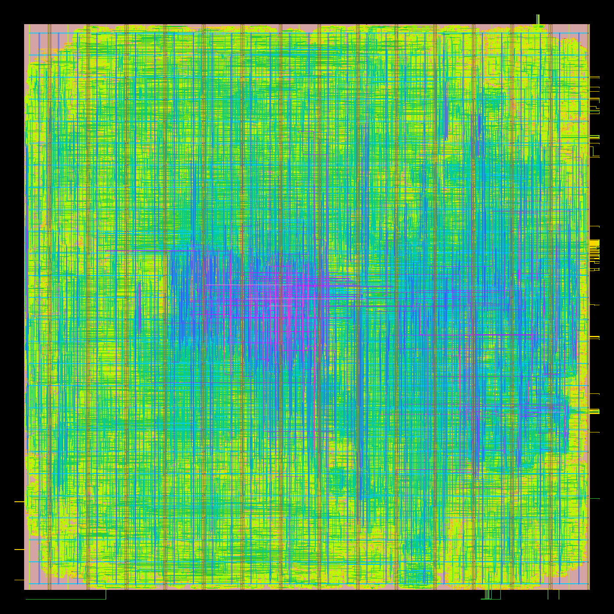
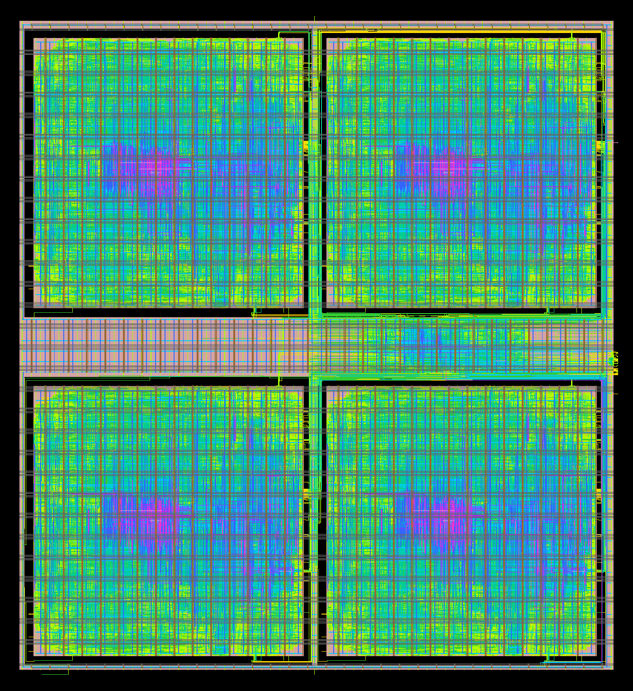

# v3 at 3 nm: GT3

The 2 nm v3 study (`docs/v3_gt2n.md`) repeated on GT3, Georgia Tech's 3 nm GAAFET predictive PDK: study S2 (the PE cost of every format and accumulator), the two levers (truncated product, weight clock gating) and the v2 SF16 chip. S1 (numerics) does not depend on the node and was not rerun. Everything ran on one RunPod 32-vCPU / 128 GB pod (`openroad/orfs:latest`) on 2026-10-06. All figures are measured (ORFS, OpenSTA, Icarus Verilog); none are modeled.

**Headline.** GT3 has one RVT library at 0.7 V, and nothing in S2 meets the 2 nm clock (500 ps). The comparison is therefore at 1000 ps (1 GHz), which all four comparison variants meet (900 ps does not). There, with every lever, SF16 SF24 is 1.70× FP16 and 1.47× BF16 in TFLOPS/mm², and 2.65× and 2.24× in TFLOPS/W; SF28 (FP16's quality) is 1.49× / 1.29× and 2.13× / 1.80×. The area ratios match 2 nm's to within 1%; the energy ratios are 5–9% higher than at 2 nm. FP16 and BF16 still clock higher (with two more pipeline stages), by more than at 2 nm: SF16 SF24's maximum clock is 0.89× FP16's and 0.82× BF16's (0.93× and 0.91× at 2 nm). Every block is about half as fast as at 2 nm (1.0–1.6 GHz against 2.0–3.0 GHz) at about the same area per MAC.

## Platform

ORFS has no GT3 platform, so `v3/platform_gt3/` is one (its README has the details), modeled on ORFS's `gt2n` (same group; the same 0.042 × 0.144 µm site and front-side M0–RDL stack).
- **Source:** [azadnaeemi/GT3](https://github.com/azadnaeemi/GT3) at `65050ce` (2025-11-14), BSD-3-Clause.
- **Library:** 64 cells with timing, all RVT, one nanosheet width, typical corner 0.7 V / 25 °C only (the LEF also has `dffasync_x2`/`x4`, which have no Liberty or GDS). There is no Vt or width menu to use: GT2N's gt2n platform loads ten flavours.
- **Written for it:** `config.mk`; front-side power onto the cells' buried power rails (BPR as a routing layer, a VBPR via to M0, aligned power-tap columns, an M3/M6/M7 grid: GT3 has no backside layers and no tap cell); per-layer RC from GT3's ITF (`setRC.tcl`); tie cells borrowed from GT2N (GT3 has none); patches to the upstream cell LEF (69 input pins declared `INOUT`), tech LEF (a `Via4Array` coordinate) and Liberty (no default operating conditions, so OpenSTA saw no supply and reported zero switching power).
- **Bring-up:** ORFS's `gcd` through `make` to the end: 8.95 µm die, 0 detailed-route violations, GDS merged with every cell matched, every power shape connected. Its minimum period is 423 ps, where gt2n's gcd targets 170 ps.
- **Routing layers:** signals M2–M10 (`MAX_ROUTING_LAYER` M10 on every design, as on GT2N); the tile's block power pins on M11 and the chip's grid on M12.

**Gaps:**
- The power taps are modeled: GT3 has no tap cell, and the BPR-to-M0 via stands for its VBPR–SDCON–VSD stack.
- The tie cells are GT2N's (geometry and Liberty), the platform's only non-GT3 cells.
- One corner, one Vt; no latch, clock-gate, adder, mux or decap cell.
- No OpenRCX rules: timing and power use estimated parasitics (`setRC.tcl`), as on GT2N. DRC and LVS decks are ICV-only, so designs are routed with zero detailed-route violations, not signed off.
- GT3's Liberty has negative internal-power entries at ordinary loads, so a block's clock-network internal power comes out negative: −1.0 to −2.9 mW on the four comparison blocks at 1 GHz, 6–9% of each total. OpenSTA's totals are used as they come; the bias is a similar fraction in every format, so it moves the ratios by a few percent at most.
- No SRAM macros in the PDK, so there is no SRAM density to report.

## S2 and the levers at GT3

Method as at 2 nm: each variant is an 8 × 8 block of v3 PEs, taken through ORFS to global routing; power is gate-level switching activity on the same GPT-2 stimulus (`v3/pe/stim`, node-independent), with OpenSTA and global-route parasitics; maximum clock is 1 / (300 ps − register-to-register slack) from a 300 ps run; per-MAC figures are the block's / 64. The scripts are `v3/pe/orfs/` with `PLATFORM=gt3`; `worker.sh` ran the 84 flows up to eleven at a time. The levers' stimulus is the base variants' (`v3/pe/derive_stim.py`: the same operands; SF28's partial sums are SF32's in 28-bit lanes), which is what `power_stim.py` writes for them.

**Clock.** At 500 ps, none of the four comparison variants meets timing (register to register: SF16 SF24 t+g −280 ps, SF28 t+g −371 ps, FP16 FP24 (a) t+g −163 ps, BF16 FP24 (a) g −146 ps). A 900 ps run of SF16 SF28 t+g missed by 10.4 ps, so the iso-clock period is 1000 ps (1 GHz), which all four meet. All 28 variants ran at 1000 ps (power), 500 ps (power) and 300 ps (maximum clock). Variants that miss 1000 ps (FP and BF16 with two stages, and SF16 SF32 rows) are for reference, as the ones that missed 2 GHz were at 2 nm.

### All variants at 1000 ps (1.00 GHz)

| Variant | Stages | Meets | Area/MAC (µm²) | Energy/MAC (fJ) | TFLOPS/mm² | TFLOPS/W | Max clock (GHz) |
|---|---|---|---|---|---|---|---|
| SF16, 16-bit (v2) | 1 | yes | 69.4 | 238 | 28.8 | 8.41 | 1.17 |
| SF16, SF24 | 1 | yes | 76.3 | 277 | 26.2 | 7.22 | 1.17 |
| SF16, SF32 | 1 | yes | 83.6 | 317 | 23.9 | 6.31 | 1.13 |
| FP16, native | 2 | no | 105.4 | 523 | 19.0 | 3.82 | 1.06 |
| FP16, FP24 | 2 | no | 116.8 | 562 | 17.1 | 3.56 | 0.99 |
| FP16, FP32 | 2 | no | 125.8 | 612 | 15.9 | 3.27 | 0.99 |
| BF16, native | 2 | no | 86.9 | 400 | 23.0 | 5.00 | 1.06 |
| BF16, FP24 | 2 | no | 92.5 | 438 | 21.6 | 4.57 | 1.08 |
| BF16, FP32 | 2 | no | 115.0 | 538 | 17.4 | 3.72 | 0.98 |
| FP16, native (a) | 3 | yes | 112.9 | 575 | 17.7 | 3.48 | 1.46 |
| FP16, FP24 (a) | 3 | yes | 124.1 | 633 | 16.1 | 3.16 | 1.42 |
| FP16, FP32 (a) | 3 | yes | 133.9 | 702 | 14.9 | 2.85 | 1.35 |
| BF16, native (a) | 3 | yes | 95.9 | 464 | 20.9 | 4.31 | 1.63 |
| BF16, FP24 (a) | 3 | yes | 100.4 | 502 | 19.9 | 3.98 | 1.50 |
| BF16, FP32 (a) | 3 | yes | 122.9 | 625 | 16.3 | 3.20 | 1.49 |
| SF16, SF24, rows (none dropped) | 1 | yes | 75.7 | 274 | 26.4 | 7.30 | 1.32 |
| SF16, SF24, truncated | 1 | yes | 68.8 | 244 | 29.1 | 8.20 | 1.31 |
| SF16, SF24, truncated + gated | 1 | yes | 67.7 | 209 | 29.5 | 9.56 | 1.29 |
| SF16, SF28 | 1 | yes | 81.4 | 305 | 24.6 | 6.55 | 1.19 |
| SF16, SF28, truncated | 1 | yes | 78.6 | 295 | 25.5 | 6.77 | 1.25 |
| SF16, SF28, truncated + gated | 1 | yes | 77.3 | 260 | 25.9 | 7.68 | 1.14 |
| SF16, SF32, rows (none dropped) | 1 | no | 84.0 | 318 | 23.8 | 6.29 | 1.23 |
| SF16, SF32, truncated | 1 | yes | 81.0 | 308 | 24.7 | 6.49 | 1.24 |
| SF16, SF32, truncated + gated | 1 | yes | 79.6 | 270 | 25.1 | 7.42 | 1.31 |
| FP16, FP24 (a), rows (none dropped) | 3 | yes | 122.0 | 620 | 16.4 | 3.23 | 1.50 |
| FP16, FP24 (a), truncated | 3 | yes | 115.1 | 586 | 17.4 | 3.42 | 1.47 |
| FP16, FP24 (a), truncated + gated | 3 | yes | 115.1 | 555 | 17.4 | 3.60 | 1.46 |
| BF16, FP24 (a), gated | 3 | yes | 99.7 | 468 | 20.1 | 4.27 | 1.58 |

### All variants at 500 ps (2 GHz, the 2 nm clock)

| Variant | Stages | Meets | Area/MAC (µm²) | Energy/MAC (fJ) | TFLOPS/mm² | TFLOPS/W | Max clock (GHz) |
|---|---|---|---|---|---|---|---|
| SF16, 16-bit (v2) | 1 | no | 78.7 | 243 | 50.8 | 8.21 | 1.17 |
| SF16, SF24 | 1 | no | 86.5 | 284 | 46.2 | 7.03 | 1.17 |
| SF16, SF32 | 1 | no | 94.4 | 325 | 42.4 | 6.15 | 1.13 |
| FP16, native | 2 | no | 120.7 | 536 | 33.1 | 3.73 | 1.06 |
| FP16, FP24 | 2 | no | 131.9 | 578 | 30.3 | 3.46 | 0.99 |
| FP16, FP32 | 2 | no | 140.9 | 629 | 28.4 | 3.18 | 0.99 |
| BF16, native | 2 | no | 97.9 | 409 | 40.9 | 4.89 | 1.06 |
| BF16, FP24 | 2 | no | 104.8 | 449 | 38.2 | 4.45 | 1.08 |
| BF16, FP32 | 2 | no | 128.2 | 551 | 31.2 | 3.63 | 0.98 |
| FP16, native (a) | 3 | no | 125.3 | 580 | 31.9 | 3.45 | 1.46 |
| FP16, FP24 (a) | 3 | no | 138.2 | 640 | 28.9 | 3.12 | 1.42 |
| FP16, FP32 (a) | 3 | no | 149.2 | 710 | 26.8 | 2.82 | 1.35 |
| BF16, native (a) | 3 | no | 105.0 | 467 | 38.1 | 4.29 | 1.63 |
| BF16, FP24 (a) | 3 | no | 110.6 | 508 | 36.2 | 3.94 | 1.50 |
| BF16, FP32 (a) | 3 | no | 135.8 | 631 | 29.4 | 3.17 | 1.49 |
| SF16, SF24, rows (none dropped) | 1 | no | 85.8 | 281 | 46.6 | 7.13 | 1.32 |
| SF16, SF24, truncated | 1 | no | 78.0 | 250 | 51.3 | 8.00 | 1.31 |
| SF16, SF24, truncated + gated | 1 | no | 76.8 | 216 | 52.1 | 9.25 | 1.29 |
| SF16, SF28 | 1 | no | 92.3 | 314 | 43.4 | 6.38 | 1.19 |
| SF16, SF28, truncated | 1 | no | 89.0 | 303 | 45.0 | 6.61 | 1.25 |
| SF16, SF28, truncated + gated | 1 | no | 87.4 | 267 | 45.8 | 7.49 | 1.14 |
| SF16, SF32, rows (none dropped) | 1 | no | 95.0 | 327 | 42.1 | 6.12 | 1.23 |
| SF16, SF32, truncated | 1 | no | 91.6 | 318 | 43.7 | 6.30 | 1.24 |
| SF16, SF32, truncated + gated | 1 | no | 90.5 | 278 | 44.2 | 7.19 | 1.31 |
| FP16, FP24 (a), rows (none dropped) | 3 | no | 135.4 | 627 | 29.5 | 3.19 | 1.50 |
| FP16, FP24 (a), truncated | 3 | no | 128.0 | 594 | 31.2 | 3.37 | 1.47 |
| FP16, FP24 (a), truncated + gated | 3 | no | 127.8 | 563 | 31.3 | 3.55 | 1.46 |
| BF16, FP24 (a), gated | 3 | no | 109.9 | 473 | 36.4 | 4.23 | 1.58 |

### Comparison at 1000 ps

| | SF16 SF24 t+g | SF16 SF28 t+g | FP16 FP24 (a) t+g | BF16 FP24 (a) g |
|---|---|---|---|---|
| Area/MAC (µm²) | 67.7 | 77.3 | 115.1 | 99.7 |
| Energy/MAC (fJ) | 209 | 260 | 555 | 468 |
| TFLOPS/mm² | 29.5 | 25.9 | 17.4 | 20.1 |
| TFLOPS/W | 9.56 | 7.68 | 3.60 | 4.27 |
| Max clock (GHz) | 1.29 | 1.14 | 1.46 | 1.58 |
| Meets 1000 ps (slack, ps) | yes (+77.5) | yes (+0.5) | yes (+3.0) | yes (+9.3) |

### Ratios at 1000 ps (SF16 ahead by)

| | SF24 vs FP16 | SF24 vs BF16 | SF28 vs FP16 | SF28 vs BF16 |
|---|---|---|---|---|
| Area/MAC | 1.70× | 1.47× | 1.49× | 1.29× |
| Energy/MAC | 2.65× | 2.24× | 2.13× | 1.80× |
| TFLOPS/mm² | 1.70× | 1.47× | 1.49× | 1.29× |
| TFLOPS/W | 2.65× | 2.24× | 2.13× | 1.80× |
| Max clock | 0.89× | 0.82× | 0.78× | 0.72× |

### 2 nm (GT2N, 500 ps) alongside

| | SF16 SF24 t+g | SF16 SF28 t+g | FP16 FP24 (a) t+g | BF16 FP24 (a) g |
|---|---|---|---|---|
| Area/MAC (µm²) | 66.5 | 75.8 | 113.0 | 98.2 |
| Energy/MAC (fJ) | 233 | 294 | 589 | 487 |
| TFLOPS/mm² | 60.1 | 52.8 | 35.4 | 40.7 |
| TFLOPS/W | 8.60 | 6.80 | 3.40 | 4.11 |
| Max clock (GHz) | 2.62 | 2.70 | 2.82 | 2.87 |

### Checks

- 1000 ps: EQUIV a = b in 28/28 variants; annotated pins 377,791–805,743; failures: []
- 500 ps: EQUIV a = b in 28/28 variants; annotated pins 437,985–905,090; failures: []

### What changes from 2 nm

- **The ranking and the ratios hold.** At iso-clock, SF16 SF24 t+g is 1.70× FP16 and 1.47× BF16 in TFLOPS/mm² (2 nm: 1.70×, 1.48×) and 2.65× and 2.24× in TFLOPS/W (2 nm: 2.53×, 2.09×). SF28 clears 2× in TFLOPS/W against FP16 (2.13×) but not BF16 (1.80×), as at 2 nm. TFLOPS/mm² still does not reach 2× against either.
- **The levers do what they did at 2 nm.** The truncated product takes 9.8% of SF24's area and 12.0% of its energy (2 nm: 9.6%, 12%); the rows form alone saves almost nothing (75.7 µm² against 76.3). On SF28 and SF32, which keep 23 of the 30 product bits, truncation is worth only 3–3.5% of area and 3% of energy. Clock gating then takes 14.2% of SF24's energy, 11.9% of SF28's, 5.2% of FP16 FP24 (a)'s and 6.8% of BF16 FP24 (a)'s (2 nm: 15%, 5–6%).
- **Clock.** GT3's single RVT library at 0.7 V roughly halves every block's maximum clock. FP and BF16 lose less of it with their three stages, so SF16's clock deficit grows: SF24 t+g reaches 1.29 GHz against 1.46 (FP16) and 1.58 (BF16). The two-stage FP and BF16 blocks miss even 1 GHz (by 2.6–44.6 ps); SF16 SF32 rows misses it by 0.6 ps.
- **Area per MAC at 1 GHz is within 2% of 2 nm's at 2 GHz** for the four comparison variants: the two PDKs share the cell site and metal pitches, and GT3's blocks need no upsizing at 1 GHz. At 500 ps, where every GT3 block fails, the tools upsize and area per MAC is 9–15% higher than at 1000 ps.
- **Energy per MAC at 1 GHz is 4–12% below 2 nm's at 2 GHz** (209 against 233 fJ for SF24 t+g, 468 against 487 fJ for BF16), which is why the energy ratios moved in SF16's favour. Part of that is GT3's negative clock internal power (Platform, gaps); the two are different clocks, libraries and Vts, so this is not a like-for-like node comparison.

## The v2 chip at GT3

The v2 SF16 core tile hardened to GDS with `generate_abstract`, then the chip core with four tile macros (configs in `v3/gt3_v2chip/`, as `v3/gt2n_v2chip/`; die from the tile LEF with `chip_size.py`, gap 6 µm, logic strip 30 µm).

The tile misses 650 ps on GT3 (−201 ps at global route) and 900 ps (−50 ps), so both were run at 1000 ps, the nearest round period the tile meets.

| | Tile | Chip |
|---|---|---|
| Die | 122.32 × 122.32 µm | 264 × 288 µm |
| Detailed-route violations | 0 | 0 |
| Setup at 1000 ps | +2.61 ps | −1,236 ps (register to output ports); register to register −790 ps |
| Hold | −30.9 ps at 7 endpoints, all from input ports; register to register +11.4 ps | −22.8 ps at 5 endpoints, register to register |
| Flip-flops | 11,495 | 2,796 outside the tiles |

- **At 2 nm** the tile was 122.15 µm square and met 650 ps (+0.35 ps), and the chip was the same 264 × 288 µm with −587 ps setup. The tile has the same flip-flops and nearly the same die at 3 nm; it runs at 1 GHz instead of 1.55 GHz.
- **The chip's failing paths are top-level, as at 2 nm.** Its clock tree reaches the top-level registers at 1,470–1,540 ps and the tiles' clock pins at 790–870 ps (the tiles' own trees add 400–470 ps inside). So the shared icache's output registers launch 600 ps after the tiles' program-memory inputs capture (−790 ps), the outputs leave about 1,500 ps after the ideal clock edge and miss their 800 ps budget by up to 1,236 ps, and the five hold failures end at the bus's b0/b1 address and data registers (the worst from a tile output, −22.8 ps).
- **The tile's hold failures** are its input ports: the SDC's 200 ps input delay against a 400–470 ps clock insertion delay. Register to register it holds with +11.4 ps.

Renders (KLayout, `v3/figs/render_gds.py`; ACT, GATE and M0–M11, plus M12 on the chip):

| Tile | Chip |
|---|---|
|  |  |

## Run

- Pod `sf-gt3`, 32 vCPU / 128 GB at $1.28/h, about 6.1 h (about $7.8, from the container's start at 12:10 UTC to termination at 18:17 UTC).
- What went wrong and was redone: a 650 ps tile route was lost when its shell hung up; a 900 ps tile was stopped in detailed route once 900 ps proved short; four 900 ps S2 runs were dropped for the same reason; the first `sf16_sf24` 500 ps run (the smoke test) predates the Liberty patch and was rerun. At 16:23 the pod's 100 GB disk filled with ORFS intermediates and 12 in-flight runs failed; they were rerun from scratch and `worker.sh` now keeps only each run's routed block. Every result above is from a run that completed and passed its checks.
