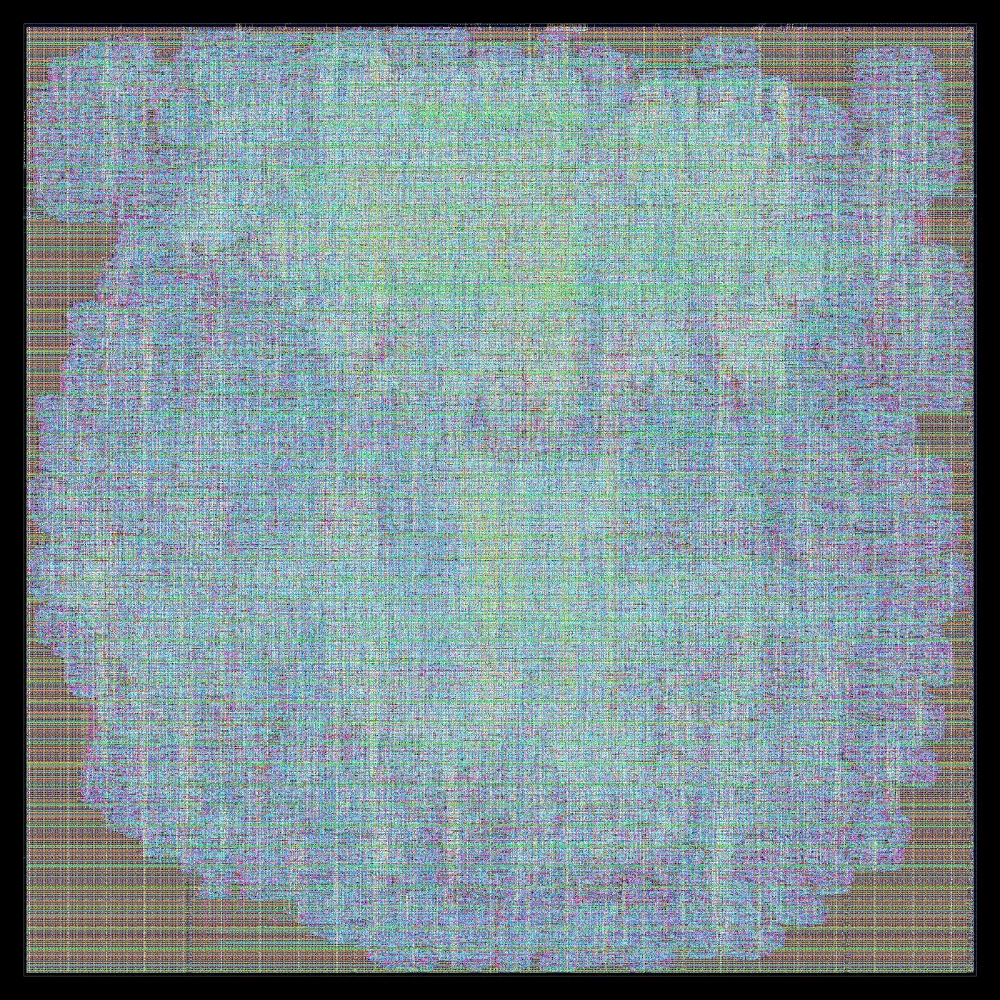
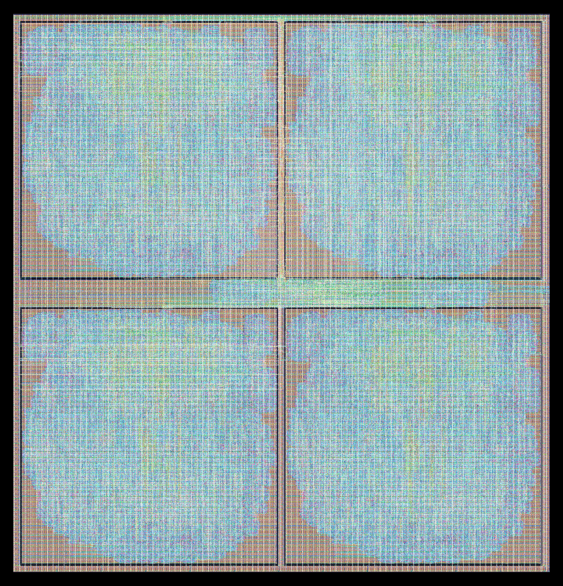

# v3 at 45 nm: NanGate45

The 2 nm v3 study (`docs/v3_gt2n.md`) repeated at 45 nm on ORFS's own `nangate45` platform (the NanGate 45 nm Open Cell Library on FreePDK45; `v3/platform_nangate45/README.md`): study S2 (the PE cost of every format and accumulator), the two levers (truncated product, weight clock gating) and the v2 SF16 chip. S1 (numerics) does not depend on the node and was not rerun. All figures are measured (ORFS, OpenSTA, Icarus Verilog); none are modeled.

**Headline.** At a 1.5 ns clock (667 MHz), which every comparison variant meets, SF16 SF24 with every lever is 1.90× FP16 and 1.63× BF16 in TFLOPS/mm², and 2.88× and 2.44× in TFLOPS/W; SF28 (FP16's quality) is 1.68× / 1.44× and 2.39× / 2.02×. Both ratios are larger than at 2 nm (1.70× / 1.48× and 2.53× / 2.09×). At 45 nm SF16 also clocks highest, though by little: 0.78 GHz against 0.76 (FP16, three stages) and 0.74 (BF16, three stages). The v2 SF16 tile and the chip with four of them route with zero violations and meet 1.5 ns on extracted parasitics.

## Method

As at 2 nm: each variant is an 8 × 8 block of v3 PEs through ORFS to global routing, with OpenSTA and global-route parasitics; power is gate-level switching activity on the same GPT-2 stimulus (`v3/pe/stim`), with every gate-level netlist checked against its RTL. Maximum clock is 1 / (750 ps − register-to-register slack) from a 750 ps run. NanGate45's Liberty and SDCs are in ns; the scripts (`v3/pe/orfs/`, `PLATFORM=nangate45`) name runs in ps.
- **Iso-clock period:** 1.5 ns, the shortest of 1.0, 1.25 and 1.5 ns that SF16 SF24 t+g, SF28 t+g, FP16 FP24 (a) t+g and BF16 FP24 (a) g all meet (at 1.25 ns they miss by 24–115 ps, at 1.0 ns by 279–365 ps).
- **Runs:** the 1.5 ns runs with power on a RunPod pod (2026-10-06/07); the 750 ps runs, the tile and the chip on a 64-core Modal container (2026-10-07), after the pod and its 750 ps reports were lost.

## S2 and the levers at 1.5 ns (667 MHz)

| Variant | Stages | Meets 1.5 ns | Area/MAC (µm²) | Energy/MAC (fJ) | TFLOPS/mm² | TFLOPS/W | Max clock (GHz) |
|---|---|---|---|---|---|---|---|
| SF16, 16-bit (v2) | 1 | yes | 2,068 | 2,323 | 0.64 | 0.86 | 0.73 |
| SF16, SF24 | 1 | yes | 2,294 | 2,772 | 0.58 | 0.72 | 0.74 |
| SF16, SF32 | 1 | yes | 2,493 | 3,174 | 0.53 | 0.63 | 0.72 |
| FP16, native | 2 | no | 3,977 | 6,241 | 0.34 | 0.32 | 0.58 |
| FP16, FP24 | 2 | no | 4,415 | 6,967 | 0.30 | 0.29 | 0.54 |
| FP16, FP32 | 2 | no | 4,942 | 8,151 | 0.27 | 0.25 | 0.53 |
| BF16, native | 2 | no | 3,316 | 4,996 | 0.40 | 0.40 | 0.59 |
| BF16, FP24 | 2 | no | 3,575 | 5,715 | 0.37 | 0.35 | 0.59 |
| BF16, FP32 | 2 | no | 4,454 | 7,130 | 0.30 | 0.28 | 0.53 |
| FP16, native (a) | 3 | yes | 3,727 | 6,261 | 0.36 | 0.32 | 0.80 |
| FP16, FP24 (a) | 3 | yes | 4,095 | 6,897 | 0.33 | 0.29 | 0.76 |
| FP16, FP32 (a) | 3 | no | 4,430 | 7,696 | 0.30 | 0.26 | 0.73 |
| BF16, native (a) | 3 | yes | 3,032 | 4,938 | 0.44 | 0.41 | 0.76 |
| BF16, FP24 (a) | 3 | no | 3,317 | 5,612 | 0.40 | 0.36 | 0.74 |
| BF16, FP32 (a) | 3 | yes | 4,100 | 7,029 | 0.33 | 0.28 | 0.71 |
| SF16, SF24, rows (none dropped) | 1 | yes | 2,284 | 2,762 | 0.58 | 0.72 | 0.75 |
| SF16, SF24, truncated | 1 | yes | 2,042 | 2,442 | 0.65 | 0.82 | 0.75 |
| **SF16, SF24, truncated + gated** | 1 | yes | **1,997** | **2,163** | **0.67** | **0.92** | 0.78 |
| SF16, SF28 | 1 | yes | 2,383 | 3,000 | 0.56 | 0.67 | 0.73 |
| SF16, SF28, truncated | 1 | yes | 2,297 | 2,884 | 0.58 | 0.69 | 0.75 |
| **SF16, SF28, truncated + gated** | 1 | yes | **2,256** | **2,607** | **0.59** | **0.77** | 0.76 |
| SF16, SF32, rows (none dropped) | 1 | yes | 2,512 | 3,178 | 0.53 | 0.63 | 0.74 |
| SF16, SF32, truncated | 1 | yes | 2,368 | 3,011 | 0.56 | 0.66 | 0.75 |
| SF16, SF32, truncated + gated | 1 | yes | 2,308 | 2,715 | 0.58 | 0.74 | 0.75 |
| FP16, FP24 (a), rows (none dropped) | 3 | yes | 4,078 | 6,870 | 0.33 | 0.29 | 0.75 |
| FP16, FP24 (a), truncated | 3 | yes | 3,849 | 6,524 | 0.35 | 0.31 | 0.78 |
| **FP16, FP24 (a), truncated + gated** | 3 | yes | **3,794** | **6,225** | **0.35** | **0.32** | 0.76 |
| **BF16, FP24 (a), gated** | 3 | yes | **3,256** | **5,276** | **0.41** | **0.38** | 0.74 |

TFLOPS/mm² is 2 FLOPs per MAC per cycle at 667 MHz over the area per MAC; TFLOPS/W is 2 FLOPs over the energy per MAC. Variants that miss 1.5 ns (FP and BF16 with two stages, and BF16 FP24 (a) without the gate) are for reference. Every block's gate-level netlist matches its RTL on the stimulus (1,014–1,015 lines for SF16, 998–1,006 for FP and BF16).

**Compute with every lever, SF16 ahead by:**

| SF16 ahead by | vs FP16 | vs BF16 |
|---|---|---|
| SF24, TFLOPS/mm² | 1.90× | 1.63× |
| SF24, TFLOPS/W | 2.88× | 2.44× |
| SF28, TFLOPS/mm² | 1.68× | 1.44× |
| SF28, TFLOPS/W | 2.39× | 2.02× |
| Max clock (SF24) | 1.03× | 1.06× |

**Against 2 nm (GT2N) and 3 nm (GT3):**

| SF24 t+g ahead by | 45 nm vs FP16 / BF16 | 3 nm vs FP16 / BF16 | 2 nm vs FP16 / BF16 |
|---|---|---|---|
| TFLOPS/mm² | 1.90× / 1.63× | 1.70× / 1.47× | 1.70× / 1.48× |
| TFLOPS/W | 2.88× / 2.44× | 2.65× / 2.24× | 2.53× / 2.09× |
| Max clock | 1.03× / 1.06× | 0.89× / 0.82× | 0.93× / 0.91× |

- **SF16's lead is largest at 45 nm:** its area and energy ratios are 12–15% above 2 nm's, on one planar library against two nanosheet ones.
- **The clocks are close.** At 45 nm the FP formats' three stages buy them no clock lead: all four comparison blocks top out at 0.74–0.78 GHz.

## The v2 SF16 chip at 45 nm

The v2 SF16 core tile (`v2_tile`) hardened to GDS, then the chip core (`v2_chip`: `superfloat_openframe`, four tile macros, the pin bus, dispatcher and shared icache, no pad ring), both at 1.5 ns, with OpenRCX-extracted parasitics (`v3/nangate45_v2chip/`, `sta_final.tcl`; STA reports in `signoff/` and `../nodes/nangate45/v2chip.json`).

| | Tile | Chip |
|---|---|---|
| Die | 694.16 × 694.16 µm (0.482 mm²) | 1,450 × 1,510 µm (2.19 mm²) |
| Detailed-route / antenna violations | 0 / 0 | 0 / 0 |
| Setup slack at 1.5 ns | +12.2 ps | +105.1 ps |
| Hold slack | +21.2 ps | +25.4 ps |
| Flip-flops | 11,489 | 2,796 (the chip's own; tiles are macros) |

- **The chip's channels are wider than at 2 nm.** The 2 nm rule (6 µm between the tiles, a 30 µm logic strip) failed global routing at 45 nm: the chip's 30,000 µm² of cells had nowhere to route (overflow 14,902, worst on metal9 and metal7). 20 µm channels and an 80 µm strip route clean.
- **Against the other nodes:** the same chip is 15.09 mm² at 130 nm (SKY130, with OpenFrame's harness), 2.19 mm² here (6.9× smaller) and 0.076 mm² at 2 nm (29× smaller than here, with a top level that misses timing).

## Caveats

- NanGate45 is a research library on a non-manufacturable PDK, typical corner only, one Vt (platform README). Absolute numbers indicate a 45 nm planar process, not a foundry's.
- The blocks stop at global routing (estimated parasitics), as at 2 and 3 nm; the tile and chip are routed and extracted.
- No real SRAM (fakeram only), so no SRAM density at this node.
- Chip power is not reported: the final STA's power uses default switching activity, not a workload.
